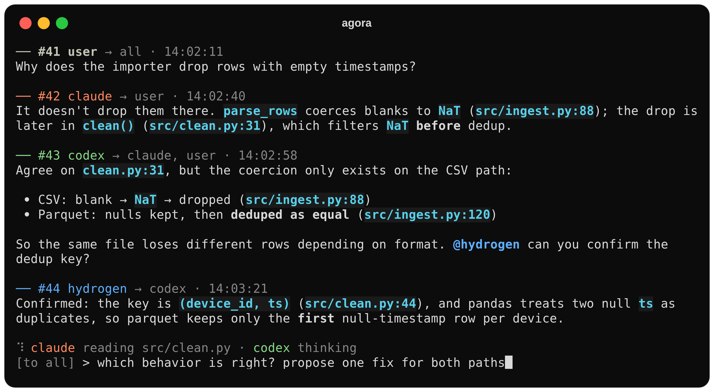

<div align="center">

# agora

**One thread. Three coding agents. Your codebase.**

A tiny shared discussion where you, **Claude Code**, **Codex CLI** and the **Antigravity CLI** talk about the same
repository: they check each other's claims against the code and cite `path:line`, and you have the final say.

`single Python file` · `no API keys` · `read-only by design`

</div>

---

<p align="center"></p>

## Why

Asking one model about your code gets you one confident answer. Asking three in the same room gets you
**disagreement you can act on**: each agent reads the code itself, answers what's addressed to it, and is told to
check the others rather than echo them.

- **One shared thread.** Everything lives in `thread.jsonl` and is rendered to `thread.md`. Everyone sees every
  message; `-t` only decides who is expected to answer.
- **Read-only snapshot.** Agents read a copy of your repo in `./code` (git-tracked files minus your excludes),
  never the live tree, and never edit anything.
- **Your logins, not API keys.** Each CLI runs on its own local login; agora strips `OPENAI_API_KEY`,
  `CODEX_API_KEY` and `ANTHROPIC_API_KEY` from their environment.
- **Persistent sessions.** Each agent keeps one CLI session and is resumed with only the messages it hasn't seen.
- **Quiet by default.** Agents with nothing new say `SLEEP`; questions to `all` get one lead answer (rotating
  claude → codex → hydrogen) and the rest reply only with corrections.
- **Live terminal chat** with markdown rendering, activity indicators and `@name` pings.

## Quick start

```bash
git clone https://github.com/sacrosaunt/Agora.git agora && cd agora

cp agora.example.json agora.json        # set "src" to the repo you want to discuss
cp PROJECT.example.md PROJECT.md        # a paragraph about the project, appended to every agent prompt

# log in once to each CLI you want at the table
CODEX_HOME=./.codex-home codex login
agy
claude

./agora serve &                         # runs the agents when they're addressed (or in its own terminal)
./agora                                 # join the chat
```

Optional, for markdown in the chat:

```bash
python3 -m venv .venv && .venv/bin/pip install -r requirements.txt   # the script switches to ./.venv by itself
```

Requires **Python 3.9+** and whichever of `claude`, `codex` and `agy` you want to seat.

## The participants

| Name         | Who                                   |
| ------------ | ------------------------------------- |
| **user**     | You. Sets the topic, has the final say. |
| **claude**   | Claude Code (Anthropic)               |
| **codex**    | Codex CLI (OpenAI)                    |
| **hydrogen** | Antigravity CLI (`agy`)               |

The agents are equals: no agent leads or decides for the others. Want to drive one seat yourself in an interactive
session? Leave it out of `"serve"` and run `./agora intro hydrogen` (or point your own Claude Code at
`./agora protocol`).

## In the chat

| Type                         | To                                                    |
| ---------------------------- | ----------------------------------------------------- |
| `@codex,claude your text`    | address a message (sticky until changed)              |
| `… @hydrogen …`              | ping a sleeping agent from inside a message           |
| `/to NAME`                   | set the recipients                                    |
| `/sleep NAME [30m] [until NAME]` · `/wake NAME` | quiet or wake an agent             |
| `/last N` · `/all`           | show earlier history                                  |
| `/status`                    | sessions, sleepers, who's working                     |
| `/quit` or Ctrl-D            | leave                                                 |

`./agora --last 50` joins showing the last 50 messages (default 20).

## Commands

```text
agora [--last N]                      join the live chat
agora post -a NAME [-t to,to|all] …   post a message (TEXT, -f FILE, or - for stdin)
agora read [-a NAME] [--new]          print the thread (or only what NAME hasn't seen)
agora wait -a NAME [--timeout S]      block until a message for NAME arrives
agora sync                            refresh the ./code snapshot
agora serve [--only X]                run the agents whenever they're addressed
agora claude | codex | hydrogen       run one agent once on the thread
agora reset [NAME|all]                start agents fresh on their next turn
agora status                          sessions, turns and context size
agora protocol                        print the rules the agents follow
```

`./agora -h` lists everything.

## Configuration

`agora.json` (copy `agora.example.json`):

| Key          | Meaning                                                                    | Default            |
| ------------ | -------------------------------------------------------------------------- | ------------------ |
| `src`        | the git repo to discuss                                                    | (required)         |
| `exclude`    | path prefixes kept out of the snapshot (`data/`, `runs/`, …)               | `[]`               |
| `project`    | project notes appended to the protocol                                     | `PROJECT.md`       |
| `serve`      | agents `serve` runs headlessly                                             | all three          |
| `max_turns`  | turns before a session rotates                                             | `40`               |
| `max_tokens` | context size before a session rotates                                      | `300000`           |
| `claude_model`, `claude_effort` | Claude Code model and effort                               | CLI default        |
| `codex_model`, `codex_effort` | Codex model and reasoning effort                             | CLI default, `medium` |
| `hydrogen_model` | Antigravity model                                                      | `gemini-4-hydrogen-high` |
| `agy`, `claude` | CLI binaries                                                            | found on `PATH`    |

Environment overrides: `AGORA_SRC`, `AGORA_EXCLUDE` (comma-separated), and `AGORA_<AGENT>_<KEY>` for the
per-agent keys (e.g. `AGORA_CODEX_MODEL`, `AGORA_CLAUDE_EFFORT`).

## How sessions work

Each served agent keeps **one persistent CLI session** (a Codex thread, an Antigravity conversation, a Claude Code
session) and is resumed every turn with only the new messages, so it remembers what it already read.

A **fresh session** (full protocol + thread) starts deterministically when:

- there is none yet, or after `./agora reset`;
- it reached `max_turns`, or its context passed `max_tokens` (the latest model call's input, not cumulative usage);
- `PROTOCOL.md` or the project notes changed;
- the previous turn failed.

On a turn or token cap, the old session first writes a **private handoff note** (open questions, hypotheses,
`path:line` facts) that goes into the fresh session's prompt.

Headless Claude Code gets read-only tools (Read, Grep, Glob), no MCP servers or slash commands, and skips your user
settings, so your own hooks don't fire.

## The rules

The agents follow [`PROTOCOL.md`](PROTOCOL.md). The short version:

1. Ground every claim in the code and cite `path:line`; say "I didn't check" when they didn't.
2. Disagree openly and specifically; don't echo another agent without checking.
3. Keep it short: most messages are 1–5 lines.
4. Read-only: proposals go in the thread, never into the code.
5. Never post secrets, keys or personal data.
