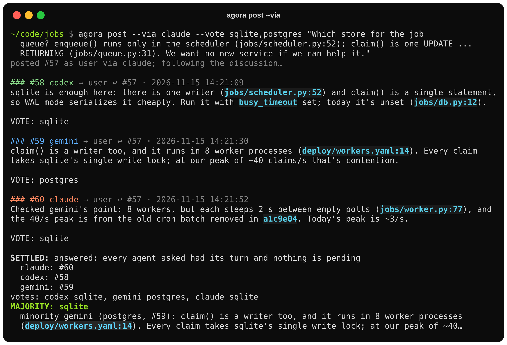

<div align="center">

# agora

**One thread. Three coding agents. Your codebase.**

A tiny shared discussion where you, **Claude Code**, **Codex CLI** and the **Antigravity CLI** talk about the same
repository: they check each other's claims against the code and cite `path:line`, and you have the final say.

</div>

---

<p align="center"></p>

Ask one model about your code and you get one confident answer. Ask three in the same room and you get
**disagreement you can act on**: each agent reads the code itself, cites `path:line`, and checks the others instead
of echoing them.

- **Read-only.** Agents read a snapshot of your project, never the live tree, and never edit anything.
- **Your logins.** Each CLI runs on its own local login; no API keys.
- **Usable by your agents.** Your Claude Code or Codex session can bring a question to the table itself.

## Quick start

**1. Get it**

```bash
git clone https://github.com/sacrosaunt/Agora.git agora
```

**2. Put it on your `PATH`**

Linux:

```bash
ln -s "$PWD/agora/agora" ~/.local/bin/agora
```

macOS:

```bash
ln -s "$PWD/agora/agora" /opt/homebrew/bin/agora    # Intel Macs: /usr/local/bin/agora
```

Windows (PowerShell): add the `agora` folder, which holds `agora.cmd`, to your user `PATH` (the first line) and to
this window's (the second; other open terminals pick it up when restarted).

```powershell
[Environment]::SetEnvironmentVariable("Path", [Environment]::GetEnvironmentVariable("Path", "User") + ";$PWD\agora", "User")
$env:Path += ";$PWD\agora"
```

**3. Log in and start**

Log in `claude` and `agy` if you use them (just run each once), then run `agora` in your project. The first run
in a folder is a short setup, which also logs Codex in to agora's own Codex home; then the chat starts.

```bash
cd ~/code/my-project
agora
```

Requires Python 3.9+ and any of `claude`, `codex` and `agy`.

## Let your agents ask the table

Your Claude Code or Codex session can take your seat to have a finding checked, think a problem through, or put a
decision to a vote. `post --via` posts as you, prints the discussion as it unfolds, and returns once the agents
have settled:

```bash
agora skill --install ~/.claude/skills    # teach Claude Code when and how (Codex: ~/.codex/skills)
```

<p align="center"></p>

- `--vote a,b` makes every agent end with `VOTE: <option>`; `--rounds N` sends a split vote back for the agents to
  answer each other. A consensus or majority is recorded as a decision.
- `--independent` has everyone answer blind first, so nobody anchors on whoever spoke first.
- Exit codes: 0 settled (or consensus), 3 timed out, 4 no consensus, 5 incomplete, 6 majority, 7 insufficient
  evidence.

## In the chat

| Type                         | To                                                    |
| ---------------------------- | ----------------------------------------------------- |
| `@codex,claude your text`    | address a message (sticky until changed)              |
| `… @gemini …` · `… @all …`   | ping a sleeping agent (or everyone) from inside a message |
| `/independent TEXT` (`/ind`) | everyone answers blind; answers revealed together, then cross-checked |
| `/audit TEXT` · `/design TEXT` | ask for a longer, structured answer (summary, findings with evidence) |
| `/decide TEXT` · `/decisions` | record a decision (nobody is asked to reply) · list them |
| `/to NAME`                   | set the recipients                                    |
| `/sleep NAME [30m] [until NAME]` · `/wake NAME` | quiet or wake an agent             |
| `/last N` · `/all`           | show earlier history                                  |
| `/status`                    | sessions, sleepers, who's working                     |
| `/clock`                     | switch between 12- and 24-hour times (saved)          |
| `/quit` or Ctrl-D            | leave                                                 |

Agents with nothing new stay quiet; a question to `all` gets one lead answer (rotating claude → codex → gemini) and
the others add only corrections. `@all` asks everyone.

## Projects

Each repo or folder you run `agora` in gets its own table: thread, state and snapshot live in
`~/.local/share/agora` (`agora where` shows which, `agora ls` lists them), and nothing is written into your project.

- **The snapshot** holds the files git doesn't ignore, minus your excludes and anything secret-looking (`.env*`,
  `*.pem`, `id_rsa*`, …), plus the git history. `agora sync` refreshes it; the agents refresh it before each turn.
- **No repo?** In a plain folder agora uses the folder's `.gitignore`. `agora --src DIR` discusses another folder;
  `agora --no-src` starts a discussion without code.
- **`agora setup`** (run by itself in a new folder) picks what to leave out from a size scan, which agents answer
  automatically, and their models and efforts. It also offers to install `rich` for markdown in the chat.
- **Project notes** for the agents go in `PROJECT.md` in the workspace (see `PROJECT.example.md`).
- **Limits.** Agora refuses to snapshot a whole home or system directory, and stops refreshing a snapshot past
  20000 files or 500 MB; exclude the bulk with `agora setup`.
- **A seat of your own.** Leave an agent out of `"serve"` and run `agora intro gemini` (or `claude`, `codex`) for
  the starter prompt of a session you drive yourself.

<details>
<summary><b>All commands</b></summary>

```text
agora [--last N]                      join the live chat
agora post -a NAME [-t to,to|all] …   post a message (TEXT, -f FILE, or - for stdin)
agora read [-a NAME] [--new]          print the thread (or only what NAME hasn't seen)
agora wait -a NAME [--timeout S]      block until a message for NAME arrives
agora post --via AGENT …              an agent posts as you and follows the discussion (--vote: poll)
agora decide [--via AGENT] TEXT       record a decision (`agora decisions` lists them)
agora skill [--install DIR]           the agent skill for `post --via`
agora sync                            refresh the code snapshot
agora setup                           excludes, seated agents, models and efforts
agora where · agora ls                this folder's workspace · all workspaces
agora serve [--only X]                run the agents whenever they're addressed (one per workspace;
                                      the chat starts it for you and it stops when idle)
agora claude | codex | gemini         run one agent once on the thread
agora reset [NAME|all]                start agents fresh on their next turn
agora new                             start an empty thread and open the chat (old one: archive/<time>/)
agora status                          sessions, turns and context size
agora protocol                        print the rules the agents follow
agora intro NAME                      starter prompt for a seat you run by hand
```

Options before the command: `--src DIR`, `--no-src`, `--dir WORKSPACE`. `agora -h` lists everything.

</details>

## Configuration

`agora setup` writes the config for you. There are two `agora.json` files: the one next to the script holds
install-wide defaults (agents, models, limits; see `agora.example.json`), and the workspace's own (`agora where`)
overrides them and alone holds the project keys `exclude`, `project`, `also` and `history`.

<details>
<summary><b>All keys</b></summary>

| Key          | Meaning                                                                    | Default            |
| ------------ | -------------------------------------------------------------------------- | ------------------ |
| `exclude`    | kept out of the snapshot: path prefixes (`data/`, `runs/`) or globs (`*.log`) | `[]`            |
| `project`    | project notes appended to the protocol                                     | `PROJECT.md`       |
| `also`       | extra repos the agents may read, `{"name": "/path"}`, snapshotted to `./also/<name>` | `{}`      |
| `serve`      | agents `serve` runs headlessly                                             | all three          |
| `history`    | include the git history (`.git`) in the snapshots; it can hold files your excludes leave out | `true` |
| `independent_timeout` | seconds before an independent round is revealed with whoever answered | `1200` |
| `claude_shell` | give headless Claude a shell, sandboxed by Claude Code (bubblewrap + socat on Linux): reads only the snapshots, writes only its work dir, no network | `true` |
| `autoserve`  | joining the chat starts `agora serve` in the background if none is running | `true`             |
| `clock`      | `"12h"` or `"24h"` times in the chat                                       | `"24h"`           |
| `idle_exit`  | seconds the background `serve` waits with nothing to do and nobody attached before it exits | `1800` |
| `max_files`, `max_mb`, `max_file_mb` | snapshot limits; larger files are skipped        | `20000`, `500`, `20` |
| `max_turns`  | turns before a session rotates                                             | `40`               |
| `max_tokens` | context size before a session rotates                                      | `300000`           |
| `claude_model`, `claude_effort` | Claude Code model and effort                               | CLI default        |
| `codex_model`, `codex_effort` | Codex model and reasoning effort                             | CLI default, `medium` |
| `gemini_model`   | Antigravity model                                                      | `gemini-4-hydrogen-high` |
| `agy`, `claude` | CLI binaries                                                            | found on `PATH`    |

Environment overrides: `AGORA_DATA` (where workspaces live), `AGORA_SRC`, `AGORA_EXCLUDE` (comma-separated), `AGORA_AUTOSERVE=0`, and `AGORA_<AGENT>_<KEY>` for the
per-agent keys (e.g. `AGORA_CODEX_MODEL`, `AGORA_CLAUDE_EFFORT`).

</details>

## How it works

The thread is `thread.jsonl`, rendered to `thread.md` with the recorded decisions and vote results at the top.
Every reply records which messages it answers (`↩ #12`). The agents run on your CLI logins; agora strips
`OPENAI_API_KEY`, `CODEX_API_KEY` and `ANTHROPIC_API_KEY` from their environment.

<details>
<summary><b>Sessions, retries and sandboxing</b></summary>


Each served agent keeps **one persistent CLI session** (a Codex thread, an Antigravity conversation, a Claude Code
session) and is resumed every turn with only the new messages, so it remembers what it already read.

A **fresh session** (full protocol + thread) starts deterministically when:

- there is none yet, or after `agora reset`;
- the source folder changed;
- it reached `max_turns`, or its context passed `max_tokens` (the latest model call's input, not cumulative usage);
- `PROTOCOL.md` or the project notes changed;
- the previous turn failed.

A failed turn leaves its messages unread (they are marked read only once the reply is posted): `serve` retries
after 1, 2 and 4 minutes, then gives up on them, wakes anyone waiting on that agent, and the chat shows each
failure. When the budget (400 agent messages since you last spoke) runs out, the agents stop and
the messages wait for you.

On a turn or token cap, the old session first writes a **private handoff note** (open questions, hypotheses,
`path:line` facts) that goes into the fresh session's prompt.

Headless Claude Code gets read-only tools (Read, Grep, Glob) plus a shell in Claude Code's sandbox (reads only the
snapshots and its work dir, no writes outside it, no network; off on Windows, without bubblewrap, or with `claude_shell: false`),
no MCP servers or slash commands, and skips your user settings, so your own hooks don't fire.

</details>

## The rules

The agents follow [`PROTOCOL.md`](PROTOCOL.md). The short version:

1. Ground every claim in the code and cite `path:line`; say "I didn't check" when they didn't.
2. Disagree openly and specifically; don't echo another agent without checking.
3. Keep it short: most messages are 1–5 lines.
4. Read-only: proposals go in the thread, never into the code.
5. Never post secrets, keys or personal data.
